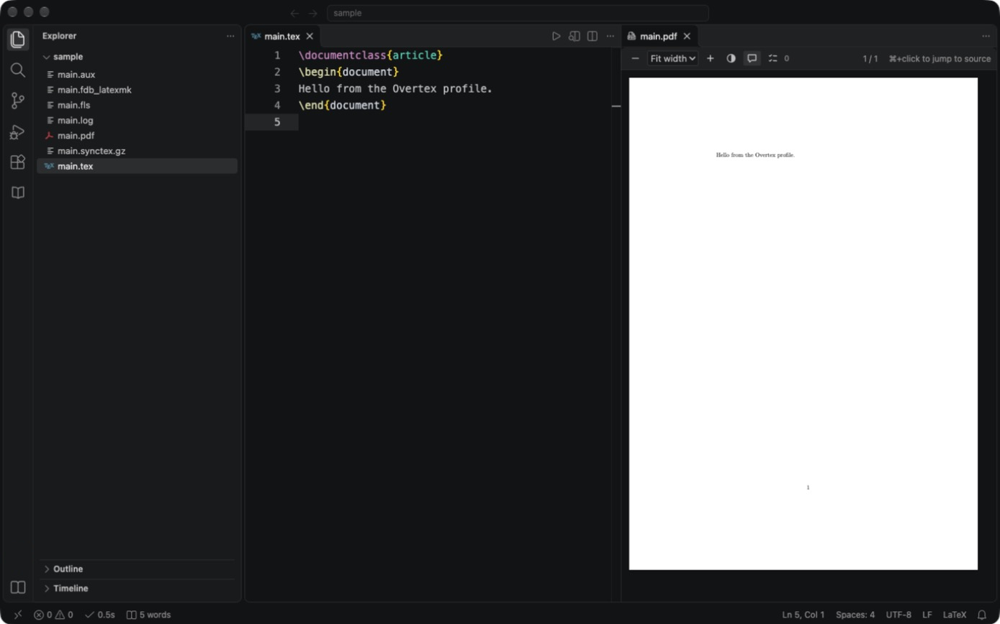

<p align="center">
  
</p>

<h1 align="center">Overtex</h1>

<p align="center">
  A LaTeX writing environment inside VS Code: build, PDF preview and SyncTeX, with nothing to set up beyond a TeX distribution.
</p>

<p align="center">
  <a href="https://marketplace.visualstudio.com/items?itemName=tansuasici.overtex"></a>
  <a href="https://marketplace.visualstudio.com/items?itemName=tansuasici.overtex"></a>
  <a href="LICENSE"></a>
</p>

## Install

Install **Overtex** from the [Visual Studio Marketplace](https://marketplace.visualstudio.com/items?itemName=tansuasici.overtex), or run:

```bash
code --install-extension tansuasici.overtex
```

You also need a TeX distribution; see [Requirements](#requirements).

### A separate, uncluttered profile

To write LaTeX in a quiet window without changing your usual VS Code setup, import the Overtex [profile](https://code.visualstudio.com/docs/configure/profiles). It installs Overtex, turns off the minimap, breadcrumbs, sticky scroll, tips and the built-in AI chat, wraps long lines, and sets a slightly larger font. The Activity Bar and status bar stay, since the Papers and Labels views and the word count live there. Build tool and executable paths are left at their defaults, so run **Overtex: Check LaTeX Installation** once after importing.

1. Open the **Command Palette** and run **Profiles: Import Profile…**.
2. Paste this URL and press Enter (or choose **Select File…** and pick [`profile/Overtex.code-profile`](profile/Overtex.code-profile) from a clone):

   ```text
   https://raw.githubusercontent.com/tansuasici/Overtex/main/profile/Overtex.code-profile
   ```

3. Choose **Create**. VS Code installs Overtex into the new **Overtex** profile; your other profiles are untouched.
4. Switch a window to it from **Profile** in the Manage (gear) menu, and back the same way. Open your paper's folder and trust it when asked, since Overtex does not build in Restricted Mode.



Overleaf Connect is not part of the profile. Install it into the profile yourself if you work on Overleaf projects; see [Overleaf (optional)](#overleaf-optional).

## Quick start

1. Run **Overtex: Check LaTeX Installation** to confirm latexmk and your engine are found.
2. Open a folder with a `.tex` file, or run **Overtex: New LaTeX Document** and pick a template (Article, Thesis or Report, Presentation, Letter).
3. Save. Overtex builds with latexmk and opens the PDF beside the editor.
4. Press `⌘⌥J` / `Ctrl+Alt+J` to jump to the cursor's spot in the PDF, and `⌘`/`Ctrl`+click in the PDF to jump back.

**Overtex: Getting Started** walks through the same steps on the Welcome page.

## Features

- **Build** with latexmk using pdfLaTeX, XeLaTeX or LuaLaTeX. BibTeX/Biber passes run automatically. Builds run on save, and a build requested while another is running is queued, not started in parallel. A build that prints nothing for five minutes, or keeps printing the same lines, is stopped, and Overtex says why. When a XeLaTeX, LuaLaTeX or Tectonic build fails on a pdfTeX-only command such as `\pdfoutput`, the error suggests building with pdfLaTeX.
- **Tectonic or Docker** instead of a TeX distribution: set `overtex.latex.tool` to build with [Tectonic](https://tectonic-typesetting.github.io/) or with latexmk inside a Docker image. See [Build tools](#build-tools).
- **Problems panel**: TeX errors and warnings are mapped to the right file and line, including files pulled in with `\input`.
- **PDF preview** beside the editor. It reloads after each build and keeps your place. Drag its tab to any split, or use the window button in its tab bar (**Move PDF Preview to New Window**) to put it on another screen. It stays where you put it, and comes back with the same PDF and page after a window reload. **Dark pages** (the toolbar's ◐ button, **Toggle Dark PDF Preview**, or `overtex.viewer.colorScheme`) show light text on a dark gray page; colors keep their hue, but figures and photos are inverted too. Set it to `auto` to follow the VS Code theme.
- **Present slides**: the preview's ▭ button (or **Present PDF as Slides**) shows one page at a time, fit to the preview on black, for Beamer talks or any PDF. → ↓ Space Page Down Enter or a click go forward, ← ↑ Page Up Backspace go back, Home and End jump to the first and last page, Esc stops. A rebuild keeps the slide, and **SyncTeX: Jump to PDF** shows the slide for the line you are on. For a projector, use **Move PDF Preview to New Window**, put that window on the projector and make it full screen with **View: Toggle Full Screen**.
- **SyncTeX**: `⌘⌥J` / `Ctrl+Alt+J` jumps from the cursor to the PDF; `⌘`/`Ctrl`+click in the PDF jumps back to the source, with the cursor on the word you clicked.
- **PDF notes**: double-click a page in the preview to pin a note there; click the pin to edit or delete it, and use the toolbar's notes button to hide them all. Notes are saved in `main.overtex-notes.json` beside the main file, so builds and Clean leave them alone and you can commit them; Export for arXiv does not include them. They are not written into the PDF. A note stays at its spot on its page, so it does not follow the text when an edit moves that text. Notes also work as a to-do list: mark one done from its editor, or open the toolbar's note list (with the open count on the button) to tick notes off, jump to them and hide the done ones.
- **Notes on the text, shared through git**: click the **+** beside a line of a `.tex` file, or select some text and run **Overtex: Add Note** (or VS Code's **Comments: Add Comment**), to leave a note for your co-authors. Notes are threads: anyone can reply, resolve and reopen them, or delete a note or a comment. The author is your `git config user.name` (your system user name in an untrusted workspace) and each comment carries its date. Notes are saved in `.overtex/notes.json` at the root of the workspace folder, so commit and push that file to share them over GitHub, GitLab or any other git host; there is no Overtex server. Each note remembers the text it is on, with a little of the text around it: after an edit, a pull or a checkout it moves to where that text is now, the nearest place when it appears more than once, and it still finds a sentence after a small change inside it. A note whose text is gone is listed under **Orphaned** in the Notes view of the Overtex sidebar; select the text it belongs to and choose **Attach to Selection**, or delete it. The notes file changes only when a note is added, answered, resolved, deleted or attached, never just because you edited the text, which keeps merge conflicts rare. If `.overtex/notes.json` cannot be read (a git conflict left in it, say), notes become read-only and the file is not overwritten until you fix it. These are separate from PDF notes, which are pinned to a spot on a PDF page.
- **To-dos**: every `\todo{…}` and `\fixme{…}` in the workspace's `.tex` files (the [todonotes](https://ctan.org/pkg/todonotes) and fixme commands) gets a mark in the gutter and is listed in the To-dos view of the Overtex sidebar, by file; click one to go there. Options such as `\todo[inline]{…}` and notes over several lines are read; commands in comments, `\iffalse … \fi` and `comment` environments are left out.
- **Live checking and completion** with [TexLab](https://github.com/latex-lsp/texlab), when it is installed: errors such as unbalanced braces, mismatched environments and undefined references appear as you type, before any build, and completion covers commands, environments, `\ref` labels and `\cite` keys. Hover and go to definition come with it.
- **Highlights**: `TODO`, `FIXME` and `XXX` comments and `\todo{…}` notes stand out in the editor and the scroll bar, and text TeX skips (`\iffalse … \fi`, `comment` environments) is dimmed. Change the color with `overtex.todoBackground` in `workbench.colorCustomizations`.
- **Math preview**: hover over math (`$…$`, `\(…\)`, `\[…\]`, `$$…$$`, `equation`, `align`, `gather` and the like) to see it rendered with [MathJax](https://www.mathjax.org/). Macros you define with `\newcommand`, `\DeclareMathOperator` or `\def` in the file or the main file are used; a mistake shows MathJax's error instead. Packages MathJax does not have are not loaded, so their commands show as undefined.
- **Reference hover**: hover over the key in `\ref`, `\eqref`, `\cref` and the like to see the number and page LaTeX gave it in the last build, read from the `.aux` files ("Equation (3), page 5", "Section 2.1 Results, page 4"), and an equation rendered. A key no `\label` defines, or one added since the last build, says so.
- **Citation completion** inside `\cite{…}` from the workspace's `.bib` files, searchable by key, title and author, when TexLab is not available.
- **Add Citation from DOI or arXiv**: paste a DOI (`10.1103/PhysRev.47.777`) or an arXiv ID (`arXiv:1706.03762`, or the abs URL) and Overtex fetches the BibTeX from doi.org, adds it to your `.bib` with a readable key, and inserts the `\cite` at the cursor.
- **Cite from Zotero**: with Zotero and its [Better BibTeX](https://retorque.re/zotero-better-bibtex/) add-on running, opens Zotero's picker, adds what you pick to your `.bib` under the citation keys Zotero shows, and inserts the `\cite` at the cursor. Papers already in the `.bib` are reused, and local attachment paths are left out. It talks only to Zotero on your computer.
- **Papers panel**: the Overtex icon in the activity bar lists the papers in the workspace's `.bib` files, grouped into Cited and Not cited and sorted by year, author or title; Ctrl/Cmd+F in the panel filters it. Cite a paper at the cursor, open its PDF, show it in the bibliography, or open its page on the web. A paper's PDF comes from its `file` field (Zotero, JabRef and Mendeley formats, or a plain path), else `papers/<key>.pdf` beside the `.bib`. For arXiv papers, the download button saves the PDF there; whether `papers/` goes into git is up to your `.gitignore`. A paper opens in the same preview as your draft, which comes back on the next build or View PDF. **Add Paper** takes a DOI, an arXiv ID or BibTeX from the clipboard; local attachment paths in pasted BibTeX are left out.
- **Labels panel**: lists every `\label` in the workspace's `.tex` files by kind (sections, figures, tables, equations, theorems, code), with **Undefined references** on top. A row shows how often a label is referenced, or that it is unused, and warns when it is defined more than once. Expand it to see each definition and reference, click to go there, insert a `\ref` at the cursor, or rename the label everywhere, in closed files too; renaming an undefined reference fixes a typo in one step. Comments and verbatim text are skipped, and `\cref`, `\autoref`, `\hyperref[…]` and friends count as references. Go to definition, find references and F2 rename work on labels with or without TexLab; when TexLab runs they follow its project (the files linked by `\input`), while the panel's own rename covers the whole workspace. The panel reads every `.tex` file in the workspace, so unrelated documents in one folder are counted together, and it does not see labels from `\externaldocument` or from keys built with macros.
- **Tables and figures**: drop a `.csv` or `.tsv` file into a `.tex` file to insert it as a `table` with a [booktabs](https://ctan.org/pkg/booktabs) `tabular`: special characters are escaped, number columns are right-aligned, and semicolon files with decimal commas (`1,5`) read right. Drop an image (`.png`, `.jpg`, `.pdf`, `.eps`) to insert a `figure` with `\includegraphics`; an image from outside the main file's folder is copied into `figures/` there. Both get a caption and a unique `\label` to fill in, and `\usepackage{booktabs}` or `{graphicx}` is added to the main file's preamble when missing. Hold Shift while dropping to drop into the editor. **Insert Table from CSV** and **Insert Figure** do the same from a file dialog, and Insert Table turns selected tab-separated text, as pasted from a spreadsheet, into a table in place. Undo takes the inserted text back out but leaves a copied image in `figures/`.
- **Export for arXiv**: builds the project and writes `main-arxiv.zip` beside the main file with exactly the files TeX read: your `.tex` sources, figures, local `.sty`/`.cls` files and the generated `.bbl` (arXiv does not run BibTeX), without build leftovers. Comments are removed from `.tex` files, since arXiv publishes the source, and `\pdfoutput=1` is added for pdfLaTeX projects. It warns about things arXiv may reject: a biber `.bbl`, a missing `.bbl`, a XeLaTeX or LuaLaTeX build, or inputs from outside the main file's folder.
- **Word count** in the status bar, counted with `texcount` across `\input`/`\include` files after each successful build. Set `overtex.wordCount.goal` to see `1,234 / 5,000 words`; the tooltip splits text, headings and captions and shows how many words you added this session. **Overtex: Count Words** counts on demand.
- **Check Bibliography**: checks the `.bib` in the editor (or the ones the main file names) for entries missing fields their type needs, DOIs that do not exist, point at a different paper or repeat another entry's, and arXiv preprints that have since been published, with the journal and DOI to cite instead. It also warns when a cited paper has been retracted (an error), has an expression of concern (a warning), or has a correction or newer version (a note), with the date and DOI of the notice and a link to it; these notices come from Crossref and Retraction Watch in the same doi.org lookup. It looks DOIs up on doi.org (Crossref and DataCite) and arXiv IDs on the arXiv API. Findings go to the Problems panel; entries that could not be reached are marked as unchecked, not wrong. Add Citation, Check Bibliography and Download Paper PDF are the only Overtex features that use the internet, and only when you run them; Check Spelling and Grammar runs on your computer, or with the `languagetool` engine talks only to the server in `overtex.grammar.url`, your own computer unless you change it.
- **Check Spelling and Grammar**: checks the active `.tex` file's English with [Harper](https://github.com/Automattic/harper), which runs inside Overtex: nothing to install, and the text never leaves your computer. Only the prose is checked: the preamble, comments, math, `\cite`/`\ref` keys, code and tables are left out, while section titles, captions, footnotes and `\emph{…}` text are checked. Findings go to the Problems panel; quick fixes apply a suggestion, add a word to `overtex.grammar.dictionary` or turn a rule off. The language comes from babel, polyglossia or the class options, or `overtex.grammar.language`; American, British, Australian, Canadian and Indian spelling are told apart. For other languages, set `overtex.grammar.engine` to `languagetool` and run a [LanguageTool](https://languagetool.org/) server: `brew install languagetool` and `brew services start languagetool` (port 8081, the default), or `docker run -d -p 8010:8010 erikvl87/languagetool` with `overtex.grammar.url` set to `http://localhost:8010`. Then your text goes only to the address in `overtex.grammar.url`. Neither checks Turkish. Turn on `overtex.grammar.checkOnSave` to check on each save, or set the engine to `off` to turn the check off.
- **Compare Versions**: marks up what changed between two git commits, a commit and the files on disk, or two `.tex` files, with deleted and added text shown in the PDF. Changes in `\input` files are included. It runs [latexdiff](https://ctan.org/pkg/latexdiff), which comes with TeX Live and MiKTeX, and writes `main-diff.pdf`; your sources and git state are not touched.
- **Export Review PDF**: writes `main-review.pdf`, a copy to send to co-authors or reviewers, with line numbers, your open PDF notes as margin notes beside the lines they were pinned to, and, if you pick a version, the changes since then marked up as in Compare Versions. Your sources are not changed; the copy is built in a temporary folder.
- **Export PDF with Notes**: writes `main-notes.pdf`, the PDF as it is now with your open PDF notes as standard sticky notes, so co-authors can read and answer them in Acrobat, Preview, Zotero or any PDF reader. Nothing is rebuilt and the original PDF is not changed.
- **History**: after each successful build, Overtex keeps a snapshot of the document's sources (`.tex`, `.bib`, `.sty`, `.cls` and the like in the main file's folder) and its PDF, shown in the History view of the Overtex sidebar. **Save Snapshot** takes one by hand, without building. Expand a snapshot to see the files it changed; click one to compare it with the file now, or restore that version. A snapshot can open its PDF, or be compared with the files now through latexdiff as in Compare Versions. Name a snapshot (say, "Submitted") to keep it; unnamed ones past `overtex.history.maxSnapshots` are removed, oldest first. A build that changed no source updates the newest snapshot's PDF instead of adding one. Figures are not kept. Snapshots live in VS Code's storage for the workspace, not in your project folder, and nothing is committed to git.
- **Check Submission**: builds the project and lists what reviewers and arXiv tend to reject: more pages than `overtex.submission.pageLimit`, the `draft` class option, undefined references and citations (`??`), bitmap (Type 3) fonts, `\todo`/TODO/FIXME left in the text, and PDF notes not marked done. For double-blind review, turn on `overtex.submission.anonymous` and it also points at author names, affiliations, `\thanks`, acknowledgments and `pdfauthor`. Findings go to the Problems panel and are cleared by the next build. Fonts inside included PDF figures are not checked.

## Requirements

A TeX distribution that provides `latexmk`, `synctex` and `texcount`: [TeX Live](https://tug.org/texlive/), [MacTeX](https://tug.org/mactex/) or [MiKTeX](https://miktex.org/) (MiKTeX also needs Perl for latexmk).

**Overtex: Check LaTeX Installation** looks for latexmk, the selected engine, synctex and TexLab, and says what is missing and how to install it on your system. It also notices TeX that is installed but not yet on VS Code's `PATH`, which usually means VS Code needs a restart. If latexmk is missing when Overtex starts, it offers this check once. **Overtex: Getting Started** opens a short walkthrough: install, open a document, build, preview and SyncTeX.

Or no TeX distribution at all, with Tectonic or Docker. See [Build tools](#build-tools). When nothing to build with is found, the check's **Set Up…** button offers the choices: use Tectonic or Docker if they are already installed, install Tectonic (on macOS and Linux with Homebrew it types `brew install tectonic` into a terminal for you to run; otherwise it opens the Tectonic installation guide), or install a full TeX distribution. Overtex never installs anything by itself, and switches `overtex.latex.tool` in your user settings to match what you picked.

Optional: [TexLab](https://github.com/latex-lsp/texlab#installation) for live checking and completion (`brew install texlab`, `cargo install texlab`, or a release binary on `PATH`). If the official TexLab extension is installed, Overtex leaves the language server to it.

## Build tools

`overtex.latex.tool` says what builds the document. **Check LaTeX Installation** looks for what the chosen tool needs.

**`latexmk`** (the default) uses the TeX distribution on your machine.

**`tectonic`** needs only [Tectonic](https://tectonic-typesetting.github.io/book/latest/installation/) (`brew install tectonic`). It downloads the support files a document uses on the first build and caches them, so that build needs the internet.

- It always uses XeTeX, so `overtex.latex.engine` does not apply, and pdfLaTeX-only packages may not work.
- Export for arXiv and Check Submission are not available: they need the list of files TeX read, which Tectonic does not record.
- A build stops at the first error, so you see one error at a time and the PDF is not updated until it is fixed.
- `.latexmkrc` is not read. `overtex.latex.extraArgs` go to `tectonic -X compile`.
- Clean removes the `.log`, `.synctex.gz`, `.aux` and other files Tectonic kept, with the `.aux` of `\include`d chapters.

**`docker`** runs latexmk in `overtex.docker.image` (default `texlive/texlive:latest`). Docker pulls the image on the first build; the default image takes about 9 GB of disk. Any image that provides latexmk works.

- Only the workspace folder is mounted, so `overtex.latex.outDir` must stay inside it, and files outside it, such as a `texmf` tree in your home folder, are not found.
- The network is off during the build, so a `.latexmkrc` or `-shell-escape` command cannot reach the internet.
- Jumping with SyncTeX and the word count still run on your machine, so they need `synctex` and `texcount` there. Without them, building and the preview work and those two features do not.
- Compare Versions also needs `latexdiff` on your machine, as does Export Review PDF when it marks up changes. The review copy uses the `lineno` and `marginnote` packages.
- On Windows the folder is mounted at `/workspace`, so paths in the build's output files are container paths. SyncTeX jumps, and possibly Problems panel locations, Export for arXiv and Check Submission, may not match your files. Windows is untested.

## Commands

| Command | Shortcut |
| --- | --- |
| Overtex: Build | `⌘⌥B` / `Ctrl+Alt+B` |
| Overtex: View PDF | `⌘⌥V` / `Ctrl+Alt+V` |
| Overtex: Jump to PDF (forward search) | `⌘⌥J` / `Ctrl+Alt+J` |
| Overtex: Cancel Build, Clean Auxiliary Files, Show Build Log, Toggle Dark PDF Preview, Move PDF Preview to New Window, Present PDF as Slides | |
| Overtex: Add Citation from DOI or arXiv, Add Paper, Cite from Zotero, Insert Table from CSV, Insert Figure, Check Bibliography, Check Spelling and Grammar, Compare Versions, Export Review PDF, Export PDF with Notes, Export for arXiv, Check Submission, Count Words | |
| Overtex: Add Note | |
| Overtex: Check LaTeX Installation, New LaTeX Document, Getting Started | |

## Settings

| Setting | Default | |
| --- | --- | --- |
| `overtex.latex.mainFile` | | Main file relative to the workspace. Otherwise found from `% !TEX root = …`, the active file, or a workspace search. |
| `overtex.latex.tool` | `latexmk` | What builds the document: `latexmk`, `tectonic` or `docker`. See [Build tools](#build-tools). |
| `overtex.latex.engine` | `pdflatex` | `pdflatex`, `xelatex` or `lualatex`. Tectonic ignores it. |
| `overtex.latex.outDir` | | Output directory, relative to the main file. |
| `overtex.latex.extraArgs` | `[]` | Extra arguments for latexmk (e.g. `-shell-escape`) or `tectonic -X compile`. |
| `overtex.latex.latexmkPath`, `overtex.tectonic.path`, `overtex.docker.path`, `overtex.synctex.path`, `overtex.latexdiff.path`, `overtex.texlab.path` | | Executable paths when they are not on `PATH`. |
| `overtex.docker.image` | `texlive/texlive:latest` | Image to build in when `overtex.latex.tool` is `docker`. It must provide latexmk. |
| `overtex.zotero.url` | `http://127.0.0.1:23119` | Zotero's local server, for Cite from Zotero. Change it for Juris-M (port 24119) or a remote window. |
| `overtex.texlab.enabled` | `true` | Run the TexLab language server. |
| `overtex.texlab.chktex` | `false` | Show ChkTeX style warnings while typing (through TexLab). |
| `overtex.build.onSave` | `true` | Build when a `.tex` or `.bib` file is saved. |
| `overtex.build.stallTimeout` | `300` | Seconds without output before a build is stopped as stuck. A build that keeps printing the same lines is stopped too. `0` turns both off. With Docker, the time an image pull takes does not count. |
| `overtex.viewer.autoOpen` | `true` | Open the preview after a successful build. |
| `overtex.viewer.colorScheme` | `light` | `light`, `dark` (inverted pages) or `auto` (dark with a dark theme). |
| `overtex.history.maxSnapshots` | `50` | Unnamed snapshots kept per document; `0` turns history off. Named snapshots are always kept. |
| `overtex.history.keepPdf` | `true` | Keep each snapshot's PDF, so it can be opened later. |
| `overtex.highlights.enabled` | `true` | Highlight TODO notes and dim `\iffalse` and `comment` blocks. |
| `overtex.refHover.enabled` | `true` | Show a reference's number, page and equation when hovering over its key. |
| `overtex.mathPreview.enabled` | `true` | Show rendered math when hovering over it. |
| `overtex.mathPreview.scale` | `1` | Size of the math preview. |
| `overtex.grammar.engine` | `harper` | `harper` checks English inside Overtex; `languagetool` uses the server below and checks other languages; `off` turns the check off. |
| `overtex.grammar.url` | `http://localhost:8081` | LanguageTool server for the `languagetool` engine. Text is sent only here. |
| `overtex.grammar.language` | `auto` | Language code (`en-US`, `en-GB`, `de-DE`, …; Harper reads English only); `auto` reads it from babel, polyglossia or the class options in the file or the main file, and uses `en-US` when the document names none. |
| `overtex.grammar.checkOnSave` | `false` | Check spelling and grammar on each save. |
| `overtex.grammar.dictionary`, `overtex.grammar.disabledRules` | `[]` | Words not to flag, and Harper rule names or LanguageTool rule IDs to leave out. |
| `overtex.wordCount.enabled` | `true` | Show the word count in the status bar. |
| `overtex.wordCount.goal` | `0` | Word target; `0` means none. |
| `overtex.submission.pageLimit` | `0` | Page limit for **Check Submission**; `0` means none. |
| `overtex.submission.anonymous` | `false` | Also look for author information, for double-blind review. |

## LaTeX Workshop

If LaTeX Workshop is installed and both extensions build on save, every save would run TeX twice. Overtex detects this and offers to turn off either LaTeX Workshop's auto-build or its own build on save.

## Overleaf (optional)

Overtex works on local files and does not need Overleaf. To work on an Overleaf project from VS Code, add the separate [Overleaf Connect](https://marketplace.visualstudio.com/items?itemName=tansuasici.overleaf-connect) extension, which uses Overleaf's Git integration. Overleaf Connect syncs the project and waits while a build runs, and Overtex builds and previews it. Overtex itself never connects to Overleaf.

## Workspace Trust

latexmk can run code from a project's `.latexmkrc`, so in an [untrusted workspace](https://code.visualstudio.com/docs/editor/workspace-trust) Overtex does not build, clean, compare versions or start TexLab, and ignores workspace values of `overtex.latex.tool`, `overtex.latex.latexmkPath`, `overtex.tectonic.path`, `overtex.docker.path`, `overtex.docker.image` (an image is code that runs on your machine), `overtex.latex.extraArgs`, `overtex.synctex.path`, `overtex.latexdiff.path`, `overtex.texlab.path`, `overtex.zotero.url` and `overtex.grammar.url` (so a project cannot send your text elsewhere). Opening an existing PDF still works. Trust the folder to enable building.

## Development

```bash
npm ci
npm run build       # bundle the extension and the PDF viewer into out/
npm run typecheck
npm test            # unit tests (vitest)
npm run test:e2e    # runs VS Code with the extension; needs latexmk and synctex on PATH
```

After a build, `code --extensionDevelopmentPath="$PWD" path/to/project` opens a VS Code window that runs this checkout. Bugs and ideas go to [GitHub Issues](https://github.com/tansuasici/Overtex/issues); see the [changelog](CHANGELOG.md) for what changed in each release.

## License

MIT. Bundles PDF.js and MathJax (both Apache-2.0); see [THIRD_PARTY_NOTICES.md](THIRD_PARTY_NOTICES.md).
