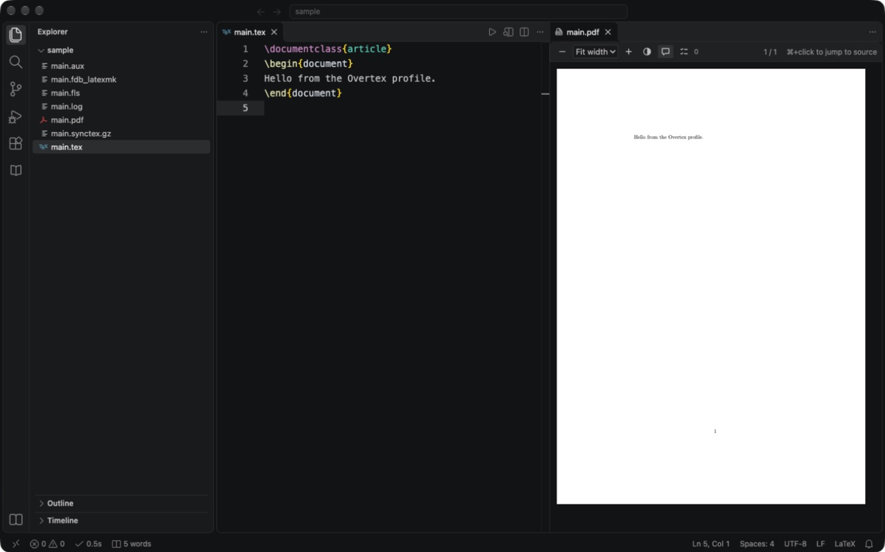

  

<h1 align="center">Overtex</h1>

  <b>Write LaTeX papers in VS Code.</b> 
  Save, and the PDF is beside you. Click it, and you are back in the source.

  
  
  

  <a href="https://marketplace.visualstudio.com/items?itemName=tansuasici.overtex"><b>Install</b></a>
  &nbsp;·&nbsp;
  <a href="https://github.com/tansuasici/Overtex/blob/main/docs/tutorial/README.md"><b>Tutorial</b></a>
  &nbsp;·&nbsp;
  <a href="https://github.com/tansuasici/Overtex/blob/main/docs/README.md"><b>Documentation</b></a>

## From first line to submission

| | |
| --- | --- |
| **Build on save** latexmk with pdfLaTeX, XeLaTeX or LuaLaTeX. Errors land on the right line in the Problems panel. No TeX installed? Use Tectonic or Docker. [Building →](docs/building.md) | **PDF preview and SyncTeX** The PDF sits beside the editor and keeps your place. Jump from a line to its spot in the PDF, and click the PDF to jump back. Dark pages and a slide mode for talks. [PDF preview →](docs/pdf-preview.md) |
| **Write faster** Errors as you type (with TexLab), math rendered on hover, a symbol picker, labels and references that rename everywhere, figures and tables by drag and drop, word count, spelling and grammar. [Writing →](docs/writing.md) | **Citations without the hunt** Paste a DOI or arXiv ID and get the BibTeX and the `\cite`. Search OpenAlex and arXiv. Pick from Zotero. Check your `.bib` for wrong DOIs, published preprints and retractions. [Bibliography →](docs/bibliography.md) |
| **Co-authors, without learning git** Share Changes and Get Changes in one click each. Invite a co-author on GitHub, or swap invite codes across GitHub, GitLab and Codeberg. [Collaboration →](docs/collaboration.md) | **Review and history** Notes on the text that travel with git, Track Changes, marked-up diffs between versions, review copies with line numbers, and a snapshot after every successful build. [Reviewing →](docs/reviewing.md) |
| **Ready to submit** Catch what reviewers reject: page limit, `??`, bitmap fonts, leftover to-dos, author names in a blind review. Then make the zip arXiv wants. [Submitting →](docs/submitting.md) | **Yours, on your computer** No account, no server, no telemetry, no AI. Only a few features you run go online, and the docs list each one. [Privacy →](docs/privacy.md) |

## Get started

1. Install **Overtex**, and a TeX distribution: [TeX Live](https://tug.org/texlive/), [MacTeX](https://tug.org/mactex/) or [MiKTeX](https://miktex.org/). Short on disk space? [Tectonic or Docker](docs/building.md#build-tools) work too.
2. Run **Overtex: Check LaTeX Installation**. It tells you what is missing and how to get it.
3. Run **Overtex: New LaTeX Document** and pick a template, or open a folder with a `.tex` file.
4. Save. The PDF opens beside the editor.

**New to LaTeX?** The [tutorial](docs/tutorial/README.md) takes you from an empty computer to a paper ready to submit in eight short lessons. No experience needed.

**Want a quiet window just for writing?** Import the [Overtex profile](docs/tutorial/01-setup.md#optional-a-quiet-writing-profile): your usual VS Code setup stays as it is.

**On Overleaf?** Add [Overleaf Connect](https://marketplace.visualstudio.com/items?itemName=tansuasici.overleaf-connect) to sync the project; Overtex builds and previews it. [More →](docs/collaboration.md#overleaf)

## Learn more

- [Documentation](docs/README.md): guides for every feature
- [Troubleshooting](docs/troubleshooting.md): when a build fails or the preview stays empty
- [Commands](docs/reference/commands.md) and [settings](docs/reference/settings.md)
- [Changelog](CHANGELOG.md) · [Issues](https://github.com/tansuasici/Overtex/issues) · [Developing Overtex](docs/development.md)

MIT licensed. Bundles PDF.js and MathJax (Apache-2.0); see [THIRD_PARTY_NOTICES.md](THIRD_PARTY_NOTICES.md).
